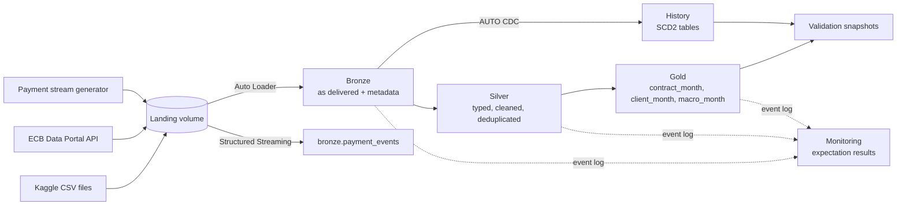

# Credit Risk Lakehouse

A medallion lakehouse for credit risk on Databricks: the
[Home Credit Default Risk](https://www.kaggle.com/competitions/home-credit-default-risk) data and
ECB macro series go from raw files to a monthly client-level default mart, with an SCD2 history
base and reproducible model-validation snapshots.

Built on Databricks Free Edition with PySpark, Delta Lake, Lakeflow Declarative Pipelines, Unity
Catalog and Databricks Asset Bundles.

## What it does



| Layer | Contents |
|---|---|
| **Bronze** | Source rows as delivered, one streaming table per file, plus `_ingested_at`, `_source_file`, `_rescued_data`. |
| **Silver** | Typed and cleaned tables: sentinels to null with `<column>_anomaly` flags, `XNA`/`XAP` to null, deterministic deduplication, quarantine tables for dropped rows. |
| **Gold** | `gold.client_month` — one row per client and month: max DPD, DPD bucket, 90+ DPD default flag, default episode start, exposure, bureau statuses, point-in-time macro columns. |
| **History** | SCD2 tables for client and contract attributes; `history.validation_dataset` / `history.validation_snapshot` for reproducible model-validation snapshots. |
| **Monitoring** | `monitoring.expectation_result` — expectation pass rates per pipeline update. |

The default definition is **90+ days past due on any Home Credit contract in the month** (the DPD
component of CRR Art. 178 only). See [docs/default_definition.md](docs/default_definition.md).

## Things to know before trusting a number

- **The calendar is synthetic.** The source has no dates, only offsets from the application date.
  Every date is derived from a single anchor (`2018-05-01`) through one helper.
- **The macro join is illustrative.** Home Credit's country is not disclosed; the ECB series are
  euro-area figures joined by the synthetic month, shifted by their publication lag.
- **`default_flag` is not `TARGET`.** It describes a client's previous contracts; `TARGET` is the
  label of the current application and is never used as a feature.
- **The payment stream is a replay** of payments already in Bronze and is never fed into Silver.
- **The data is small** (the largest Gold table is about 140 MB). Table layout is a design choice
  here, not a measurable speed-up — see [docs/perf_notes.md](docs/perf_notes.md).

## Repository layout

```
databricks.yml              bundle root, targets dev / prod
resources/                  pipeline and job definitions
src/credit_risk/
  common/                   config, schema hints, expectation rules
  transformations/          pure functions: DataFrame in, DataFrame out
  pipelines/                thin Lakeflow wrappers (bronze, silver, gold, history)
  jobs/                     job entry points (wheel scripts)
  ingestion/                Kaggle and ECB landing helpers
  streaming/                payment stream generator and consumer
  perf/                     table layout benchmark
tests/unit/                 local Spark, hand-made fixtures
tests/integration/          SQL checks against a deployed catalog
infra/terraform/            catalogs, schemas, volumes, grants
docs/                       data model, default definition, performance notes
```

Business logic lives only in `transformations/`, which is what makes it testable on a local
Spark session.

## Getting started

Requirements: Python 3.12, [uv](https://docs.astral.sh/uv/), Java 17 (for local Spark), the
Databricks CLI with a `DEFAULT` profile, Terraform ≥ 1.9, and the Kaggle files downloaded locally.

```bash
uv sync
uv run ruff check . && uv run ruff format --check .
uv run pytest tests/unit -q
```

Set up a workspace (dev shown; replace the catalog and target for prod):

```bash
# 1. Create the catalog once, in the SQL editor: CREATE CATALOG credit_risk_dev;
#    (on Free Edition the REST API cannot create catalogs)

# 2. Schemas and the landing volume
cd infra/terraform && terraform init && terraform apply -var-file=envs/dev.tfvars && cd ../..

# 3. Land the source files
uv run python -m credit_risk.ingestion.kaggle_landing --source-dir <dir> --catalog credit_risk_dev
uv run python -m credit_risk.ingestion.ecb --catalog credit_risk_dev

# 4. Deploy and run
databricks bundle deploy -t dev
databricks bundle run credit_risk_pipeline -t dev
```

Optional jobs, after the pipeline has run:

| Command | What it does |
|---|---|
| `databricks bundle run dq_report_job -t dev` | merges expectation results into `monitoring.expectation_result` |
| `databricks bundle run validation_snapshot_job -t dev --params as_of_month=2018-04-01` | appends a model-validation snapshot |
| `databricks bundle run payment_stream_job -t dev` | ingests payment micro-files landed by `credit_risk.streaming.generator` |
| `databricks bundle run copy_into_demo_job -t dev` | loads `bureau.csv` with COPY INTO for the comparison with Auto Loader |

Then check the result:

```bash
uv run pytest tests/integration -q                          # dev
CREDIT_RISK_CATALOG=credit_risk_prod uv run pytest tests/integration -q
```

The integration tests expect the optional jobs to have run on that catalog (the COPY INTO
checks need `copy_into_demo_job`).

## Environments and CI/CD

| | dev | prod |
|---|---|---|
| Catalog | `credit_risk_dev` | `credit_risk_prod` |
| Bundle target | `dev` | `prod` |
| Terraform workspace | `default` | `prod` |

- **Pull request** → ruff, unit tests, `bundle validate` for both targets.
- **Merge to `main`** → `bundle deploy -t prod`. This updates pipeline and job definitions only;
  nothing is run automatically.
- Terraform owns catalogs, schemas, volumes and grants; the bundle owns pipelines and jobs.

## Documentation

- [docs/data_model.md](docs/data_model.md) — every table, its grain, keys and quality rules
- [docs/default_definition.md](docs/default_definition.md) — the default definition and its approximations
- [docs/perf_notes.md](docs/perf_notes.md) — measured layout benchmark and COPY INTO vs Auto Loader
